# Flowdeck

**Self-hosted team work management with collaborative boards, lists, cards, and real-time updates.**

Flowdeck is a kanban-style work-management application that a team runs on its own server. You organize work into **workspaces → boards → lists → cards**, everyone uses it from a web browser, and every change appears for teammates within a second. The data stays on your server, in a PostgreSQL database and a folder of uploaded files.

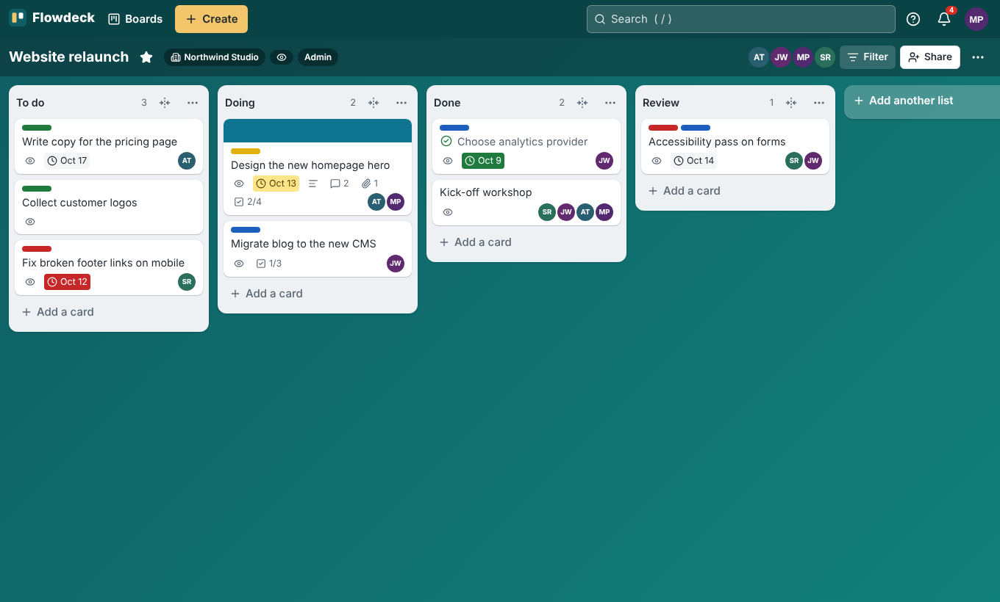

## Try it in your browser (GitHub Codespaces)

You can run Flowdeck without installing anything on your computer: GitHub hosts a temporary development machine (a *codespace*) that you use in your browser.

1. Open https://github.com/utkarshraj2004/Flowdeck (branch **`main`**).
2. Click **`<> Code`** → **Codespaces** → **Create codespace on main**, and wait for the editor to open.
3. In the editor's terminal (<kbd>Ctrl</kbd>+<kbd>`</kbd>), run `flowdeck status` until it shows `Server: ready`. Then run `flowdeck admin you@example.com` and <kbd>Ctrl</kbd>+click the one-time setup link it prints.
4. Later, open Flowdeck from the **Ports** tab: row **Flowdeck (8080)** → globe icon. The address is **private to your GitHub account**.

This is a **development preview**: it stops when idle, only you can open it, and its data is deleted with the codespace. Codespaces usage is billed by GitHub (free monthly allowance for personal accounts) and is separate from Claude credits. Full guide, including teammates, stop/resume, data and troubleshooting: **[docs/CODESPACES.md](docs/CODESPACES.md)**.

## Who it is for and what it solves

- **Small and medium teams** (designed for up to ~50 people on one server) who want familiar card-and-list workflows without a SaaS subscription.
- **Teams that must control their data**: nothing leaves your server, and there is no telemetry, no third-party login and no paid tier.
- **Collaboration problems Flowdeck handles deliberately:**
  - Two people editing the same card never silently overwrite each other.
  - A board can never lose its last admin.
  - Every action someone isn't allowed to perform is refused with a clear message, instead of appearing to succeed.

Flowdeck uses its own code, name and design. It is modelled on familiar Trello-style workflows, informed by the product research kept in [`research/`](research/README.md). It does not use Trello and does not import Trello data.

## Status

**Version 0.1.0 with unreleased additions, on `main`. Not tagged or released.** It works end to end and is covered by automated tests (see [Testing](#testing-and-github-actions)). It has not yet run for a real team over a long period. **No public instance exists**: you run your own.

What works today (details and gaps in the [implementation checklist](docs/IMPLEMENTATION-CHECKLIST.md)):

| Area | Implemented |
|---|---|
| Accounts | First administrator via a one-time setup link, email/username + password login (argon2id), logout, password change, signed-in devices (sign out one or all others), admin-issued password-reset links, self-service reset by email when SMTP is set up, disabling users |
| Workspaces | Create/rename/delete, admin and member roles, reusable invite links and single-use email-bound invites (emailed when SMTP is set up; the link can always be shared by hand), remove a member (keeping their boards as a guest, or not), last-admin protection |
| Boards | Create (with optional To do/Doing/Done, or from a board template), private or workspace visibility, backgrounds, star, rename, description, settings (who comments, who adds people, self-join, image covers), copy, close/reopen, delete (typed confirmation), JSON export |
| Board roles | Admin, member, observer, guest (board member from outside the workspace), workspace viewer with "Join board"; workspace admins administer every board in their workspace; all enforced on the server |
| Lists | Create, rename, drag to reorder, collapse, sort by name/due/date, add a card at the top or bottom, move to another board, copy, move all cards, archive all cards, archive/restore (undo with `z`), delete (after archiving), watch |
| Cards | Create, rename (also in place with quick edit), Markdown description, labels in 30 colours, members, start/due dates with due-state badges, complete toggle, checklists (reorder, convert an item to a card), comments with @mentions, file and link attachments, colour or image covers, move (also to other boards), copy with chosen parts, card templates, archive/restore/delete, watch |
| Ordering | Drag and drop with mouse and touch (long-press), keyboard moves (Space + arrows), Move dialogs; order is stored on the server and survives reloads and restarts |
| Collaboration | Live updates over WebSocket, reconnect catch-up without reloading, polling fallback, "<name> is editing" presence, explicit conflict prompts for title and description, unsaved-change protection |
| Activity and notifications | Board and card activity history, in-app notification bell (mentions, assignments, due changes, comments, attachments, completion, new cards in watched lists), grouped per card, mark as read or unread, per-kind notification settings, unread markers on card fronts (cleared when you open the card), opt-in email digests |
| Views | Board, table (sortable; edit title, list and due date in place) and calendar (month/week; drag or Alt+arrow keys to reschedule; cards without dates listed) of the same live board and filter |
| Automation and integrations | Board rules (when a card is added, moved, completed or due soon → move, label, assign, complete, set a due date, archive), run on the server with failures shown; signed outgoing webhooks with retries and a delivery log; optional SMTP email |
| Find | Board filter (keyword, members, labels, due, status, any/all) saved in the URL; global search with operators (`@user`, `#label`, `board:`, `list:`, `due:`, `has:`, `is:`, `-term`, `"phrase"`) |
| Interface | Popovers anchored to their buttons, quick edit on cards, two-column card dialog, Create menu and live search in the top bar, recently viewed boards; responsive (phone layout shows one list at a time; card details go full-screen); keyboard shortcuts (`?` lists them); accessible dialogs; colour-blind label patterns |
| Operations | Docker Compose with persistent volumes, automatic forward-only migrations with downgrade protection, health endpoints, backup and restore scripts, administration page |

## Screenshots

| Card details | Workspace members and invitations |
|---|---|
| 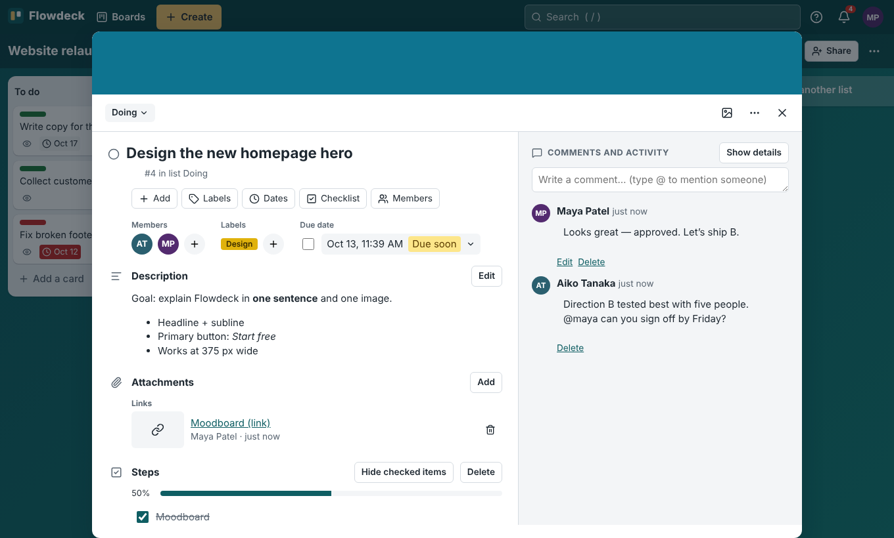 | 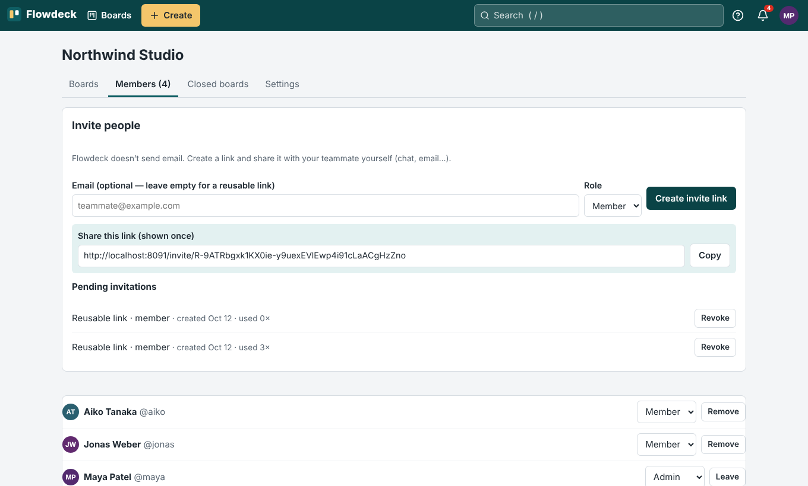 |

| Labels: 30 colours | Quick edit on the card front |
|---|---|
| 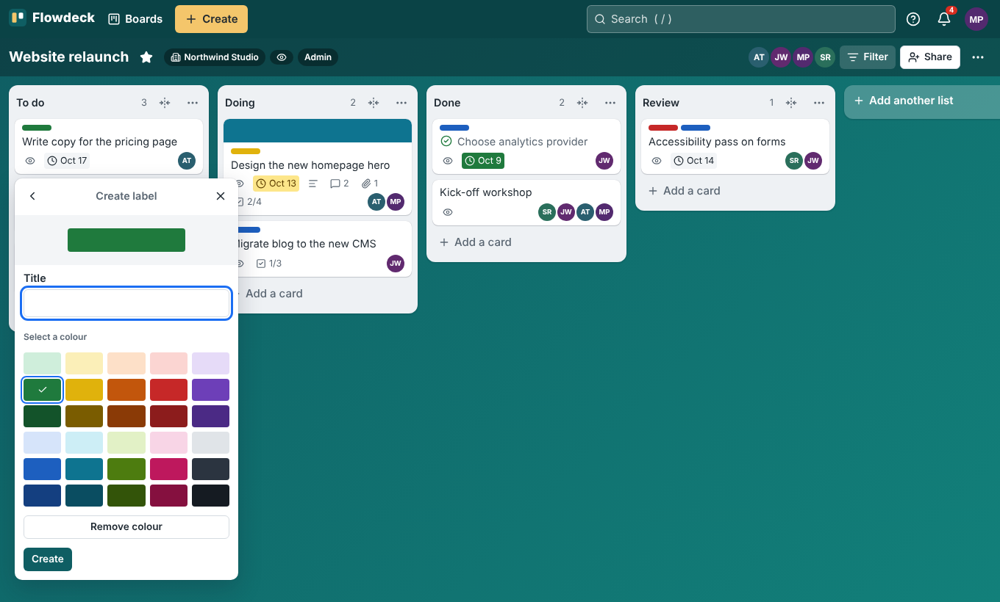 | 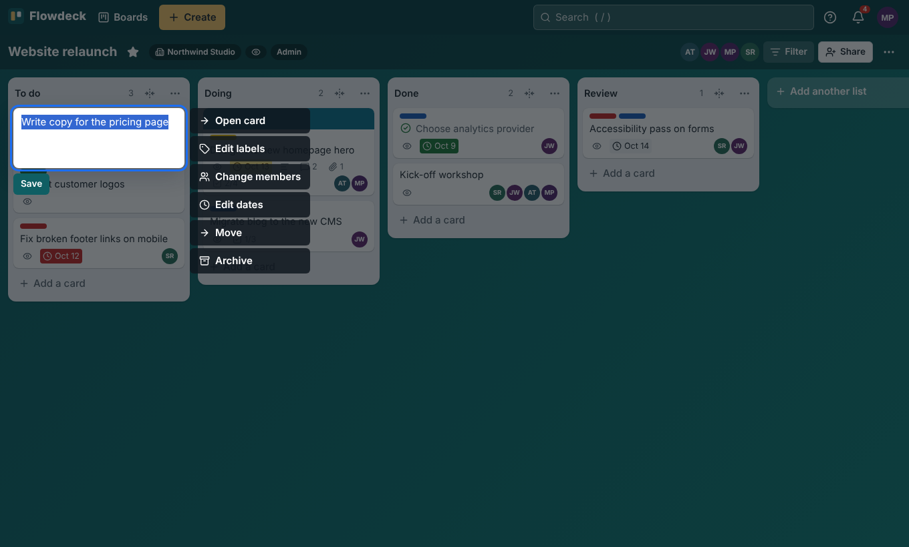 |

| Table view | Calendar view |
|---|---|
| 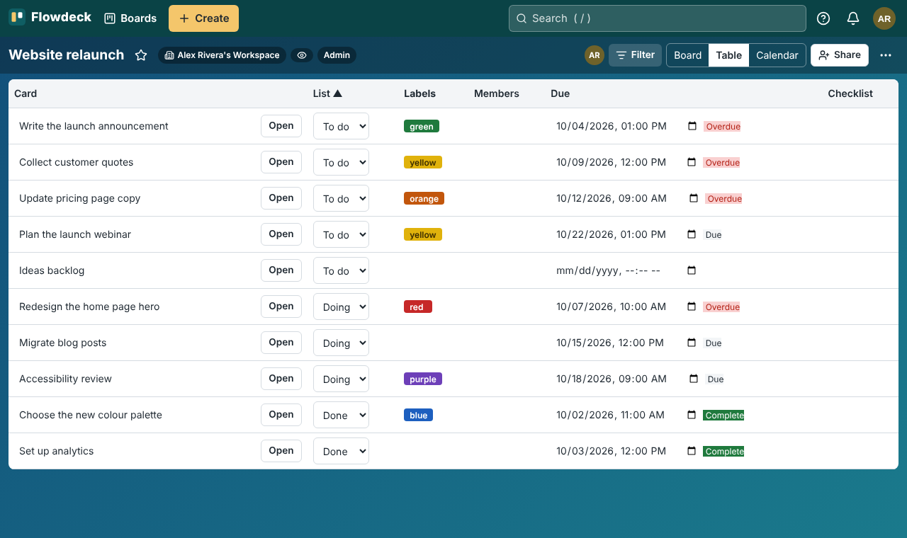 | 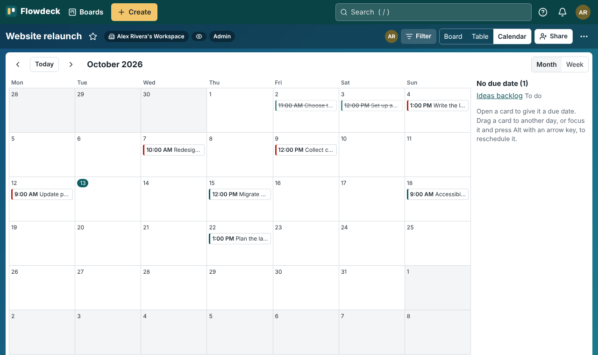 |

| Automation rules |
|---|
| 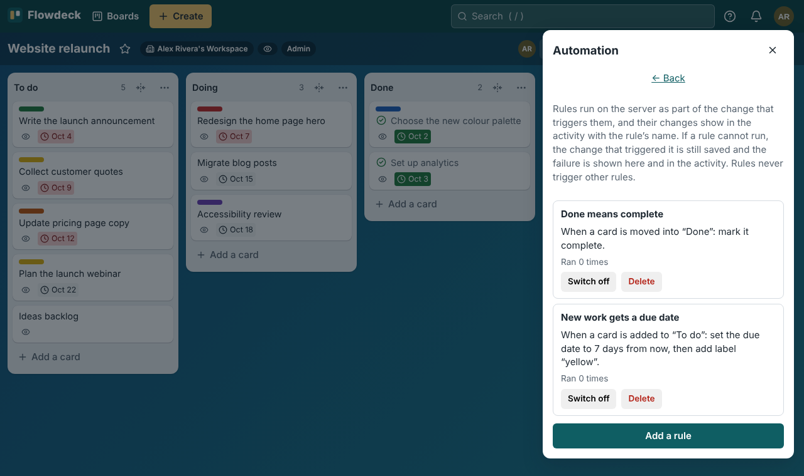 |

| Home | Phone: board | Phone: card |
|---|---|---|
| 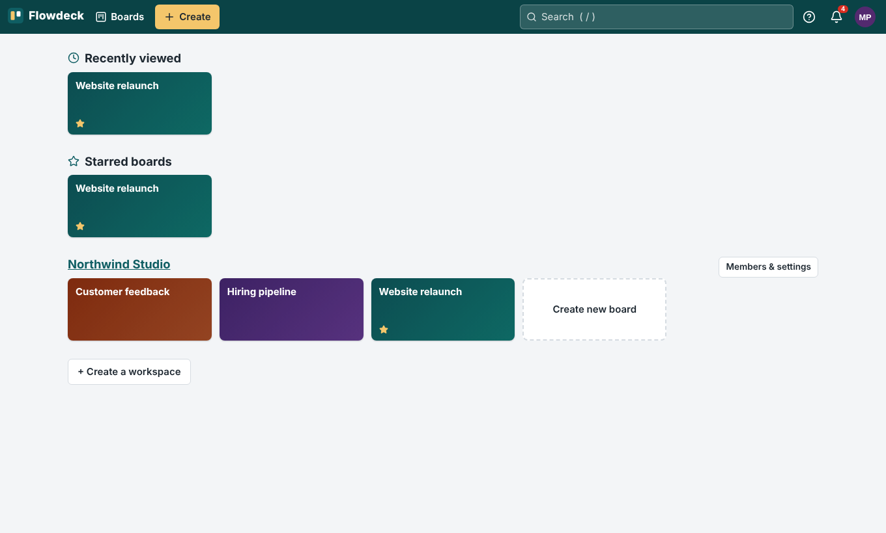 | 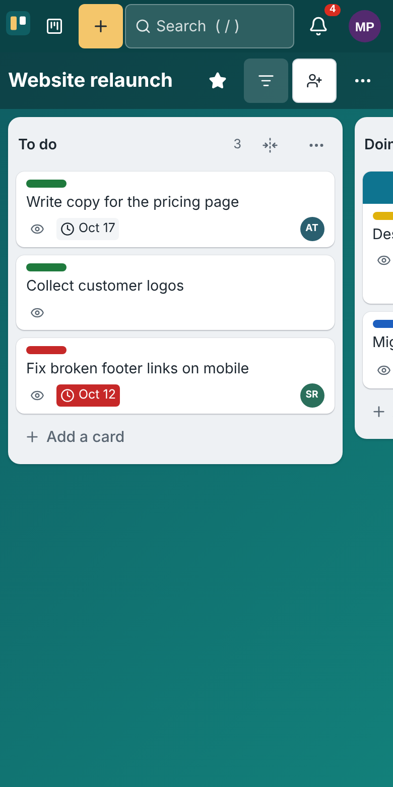 | 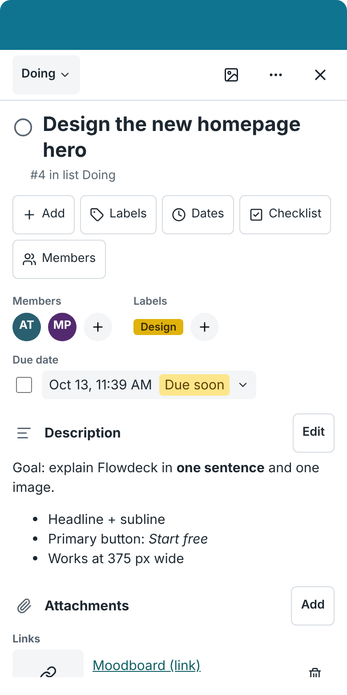 |

The screenshots show synthetic demo data in the real application. Screenshots of the previous version are in `docs/screenshots/before/` for comparison.

## How it works (architecture in brief)

```
Browser (React app)  ──HTTP + WebSocket──▶  Flowdeck app (Node.js 22, Fastify)  ──▶  PostgreSQL 16
                                                     └──▶  /data/uploads (attachment files)
```

- One **app container** serves the web interface, the REST API (`/api/v1`) and the WebSocket (`/api/v1/ws`).
- **PostgreSQL** stores everything except uploaded files. Uploaded files live in a Docker volume.
- Every change is one database transaction that also appends to a per-board event log with a gap-free sequence number. That log drives live updates, catch-up after reconnects, and the activity history.

More in [docs/ARCHITECTURE.md](docs/ARCHITECTURE.md), including the stack choice and its tradeoffs.

### Project structure

| Path | What it is |
|---|---|
| `server/src/` | Back end (TypeScript): `app.ts` (HTTP setup), `routes/` (API), `lib/` (permissions, ordering, realtime hub, search…), `cli.ts` (admin commands), `migrate.ts` |
| `web/src/` | Front end (React + Vite): `pages/`, `board/` (board, lists, cards, card dialog), `components/` |
| `migrations/` | SQL schema migrations, applied automatically at start |
| `tests/unit`, `tests/api` | Vitest unit tests and API/realtime tests against a real PostgreSQL |
| `tests/e2e` | Playwright browser tests (desktop, phone, tablet touch, accessibility) |
| `scripts/` | `backup.sh`, `restore.sh`, `compose-smoke.mjs` (deployment test), `dev-setup.sh` |
| `deploy/Caddyfile` | Optional HTTPS reverse proxy |
| `.devcontainer/` | GitHub Codespaces development preview (Node.js 22 + PostgreSQL 16, `flowdeck` helper command) |
| `docs/` | Architecture, operations, implementation checklist, handoff, screenshots |
| `research/` | **Reference material**, not product documentation: the product research and specification Flowdeck was built from |

## Requirements

- A machine your team can reach over the network (office server, NAS, small VM): Linux, macOS or Windows with **Docker Engine 24+** and the **Docker Compose v2** plugin (`docker compose version`).
- Recommended: 2 CPU cores, 2 GB RAM, 20 GB free disk (more if you upload many files).
- **Git**, to download the code.
- Teammates need a current web browser. Automated tests run in Chromium. Firefox and Safari have not been tested automatically yet.

## Run Flowdeck on your server

1. **Download the code**

   ```bash
   git clone https://github.com/utkarshraj2004/Flowdeck.git
   cd Flowdeck
   ```

   > Until the implementation pull request is merged, the code is on its branch: `git checkout claude/hopeful-galileo-us9nkk`.

2. **Configure.** Copy the example settings and edit them:

   ```bash
   cp .env.example .env
   openssl rand -hex 24        # copy the output into POSTGRES_PASSWORD
   ```

   In `.env`, set at least:
   - `FLOWDECK_BASE_URL`: the address teammates will type, for example `http://192.168.1.20:8080` (your server's LAN IP and port). This address appears in setup and invite links.
   - `POSTGRES_PASSWORD`: the random value you just generated (letters and digits only).

   Every variable is explained in [`.env.example`](.env.example) and in [docs/OPERATIONS.md](docs/OPERATIONS.md#configuration).

3. **Start it**

   ```bash
   docker compose up -d --build
   docker compose ps          # wait until "app" shows (healthy)
   ```

   The first build takes a few minutes. Database migrations run automatically.

4. **Create the first administrator**

   ```bash
   docker compose exec app node dist/server/cli.js admin create --email you@example.com
   ```

   This prints a **one-time setup link** that is valid for 24 hours. Open it in your browser and choose your name, username and password (at least 12 characters). Flowdeck creates your first workspace, with you as its admin. No account with a default password ever exists.

5. Open `FLOWDECK_BASE_URL` in your browser and create your first board.

Check health at any time with `curl http://localhost:8080/readyz` (it returns `{"ok":true,...}`).

## Connect your teammates

1. Make sure teammates can reach the server. They must be able to open `FLOWDECK_BASE_URL`, for example `http://192.168.1.20:8080`, so the port must be open in the server's firewall. For access from outside your network, use a VPN or the HTTPS setup in [docs/OPERATIONS.md](docs/OPERATIONS.md#https-and-access-from-outside-your-network).
2. In Flowdeck, open your workspace → **Members** → **Create invite link**.
   - Leave the email empty for a **reusable link** that works until you revoke it.
   - Enter an email for a **single-use invitation** that is valid for 7 days and only for that address.
3. Send the link yourself, by chat or email. **Flowdeck does not send email.**
4. The teammate opens the link and creates an account, or logs in if they already have one. They become a workspace member.
5. They can now see the workspace's boards. On a board, they click **Join board**, or a board admin adds them with **Share**, choosing Admin, Member or Observer.

Forgotten password: an administrator opens **Administration → Users → Reset link** and sends that one-time link, which is valid for 1 hour. Without the web interface, run `docker compose exec app node dist/server/cli.js admin reset-link --email them@example.com`.

## Develop in Claude Code Cloud

This repository is set up for [Claude Code](https://claude.ai/code) cloud sessions:

- On session start, a hook (`.claude/settings.json`) runs `scripts/dev-setup.sh`. The script installs npm dependencies, starts the container's PostgreSQL 16 if one is present, and creates the `flowdeck` development database.
- Ask Claude to run these commands, or run them in the session terminal:

| Command | What it does |
|---|---|
| `npm run dev` | API server on port 8080 (auto-restart) + web dev server on port 5173 |
| `npm test` | Unit, API and realtime tests (needs PostgreSQL, see `TEST_DATABASE_URL` in [CONTRIBUTING.md](CONTRIBUTING.md)) |
| `npm run build` | Compile the server and build the web client |
| `npm run test:e2e` | Browser tests (run `npm run build` first) |
| `npm run check` | Everything above, in order: run before every commit |
| `npm run cli -- admin create --email you@example.com` | Create an admin in the development database |

The development server runs inside the cloud container and **cannot be opened from your own browser**: Claude Code cloud sessions have no port forwarding or web preview. To try Flowdeck yourself without installing anything, use [GitHub Codespaces](docs/CODESPACES.md). A cloud session or codespace is not a place to host Flowdeck for your team.

The project enables the **ECC** (Everything Claude Code) plugin for Claude Code in `.claude/settings.json` (marketplace `affaan-m/ECC`, plugin `ecc@ecc`, project scope); `scripts/dev-setup.sh` adds ECC's common and TypeScript rule packs. Details and the steps after a cloud-session reset are in [docs/HANDOFF.md](docs/HANDOFF.md#ecc-everything-claude-code).

More in [CONTRIBUTING.md](CONTRIBUTING.md) and [CLAUDE.md](CLAUDE.md).

## Testing and GitHub Actions

| Suite | Count | Covers |
|---|---|---|
| Unit (`tests/unit`) | 21 | Permission matrix, search parser, board filter, due-date states, log redaction, WebSocket origin check |
| API + realtime (`tests/api`) | 46 | Two-user authorization and workspace isolation (every denied write is read back unchanged), last-admin rules, invitations, CSRF, login rate limit, ordering (including a 150-move model check and restart persistence), live delivery, reconnect replay, access revocation, conflicts, uploads (limits, headers, permissions, cleanup), notifications, search, cross-board moves, export, migrations |
| Browser (`tests/e2e`) | 16 | First-admin setup → invite → two users live; mouse, touch and keyboard moves; dialog focus (including while a card loads); edit conflicts; unsaved changes; offline → reconnect; observer/outsider/removal; uploads; filter and search; axe accessibility scan of 7 screens; phone layout |
| Deployment (`scripts/compose-smoke.mjs`) | 1 | Docker build → first admin → data → container restart → backup → wipe volumes → restore → identical export and file bytes |

The **CI** workflow (`.github/workflows/ci.yml`) runs on pull requests and on pushes to `main`, in two jobs:
- **Typecheck, API tests, build, browser tests**, with a PostgreSQL service;
- **Docker Compose smoke**.

GitHub Pages is **not** used. Flowdeck needs a server, a database and WebSockets, which Pages cannot provide.

## Data, backups, restore and upgrades

- **Where data lives:** two Docker volumes, `flowdeck_db-data` (database) and `flowdeck_uploads` (attached files). `docker compose down` keeps them; **`docker compose down -v` deletes them.**
- **Back up:** `scripts/backup.sh` writes `backups/flowdeck-<time>/` with a database dump, an archive of the uploaded files, checksums and a manifest, while Flowdeck keeps running. Schedule it (for example daily with cron) and **copy backups to another machine**.
- **Restore:** `scripts/restore.sh backups/flowdeck-<time>`. It verifies checksums, asks for confirmation, replaces the database and files, and starts Flowdeck again.
- **Upgrade:** take a backup, `git pull`, `docker compose up -d --build`. Migrations run automatically. A database from a *newer* Flowdeck version is refused instead of being damaged. To roll back, restore the backup taken before the upgrade.

Step-by-step instructions, a cron example and a restore drill are in [docs/OPERATIONS.md](docs/OPERATIONS.md).

## Troubleshooting

| Problem | What to do |
|---|---|
| Teammates can't open Flowdeck | Check that `FLOWDECK_BASE_URL` uses the server's network address (not `localhost`), that the port is open in the firewall, and `docker compose ps` |
| "This link is invalid or has expired" | Create a new setup or reset link (see above). Setup links last 24 h, reset links 1 h, and each works once |
| Red "Connection to Flowdeck lost" banner | The browser lost its live connection. Flowdeck retries automatically and catches up. If it persists, check the server and network. A reverse proxy must allow WebSocket upgrades |
| "Your session token is missing or stale" | Reload the page |
| `docker compose up` fails with a pull rate limit, or `npm ci` fails during the build with a certificate error | See [docs/OPERATIONS.md → Troubleshooting](docs/OPERATIONS.md#troubleshooting) (registry mirrors, `--secret id=extra_ca`) |
| App container keeps restarting | `docker compose logs app`. A "schema version … is newer than this Flowdeck build" message means the database was used by a newer version: run that version or restore a matching backup |

## Known limitations

- **Email is optional.** Without an SMTP server you configure, invitations and password resets are shared by hand and notifications stay in the app.
- **One server process.** Live updates use in-process messaging. Running several app replicas is not supported yet.
- **Plain HTTP on a LAN** works, but session cookies are then not marked `Secure`. Use HTTPS (Caddy profile) or a VPN for anything beyond a trusted network.
- **Touch drag** is tested with emulated touch, not on physical phones. On phones, long-press auto-scroll across lists still needs real-device confirmation. The **Move** button is always available as a tap-only alternative.
- **Concurrent editing** is field-based (explicit conflict prompts), not character-by-character co-editing.
- **Not yet:** public boards, custom fields, due-date reminders and recurring dates, automation buttons and scheduled (calendar) rules, emoji reactions, two-factor login, SSO, avatars (initials only), per-user locale and time zone (the browser's are used), retrying idempotency keys, image thumbnails. See [Roadmap](#roadmap).
- **Large boards:** a 1,200-card board loads in about 0.3–0.4 s and opens a card in about 0.27 s on a desktop machine ([docs/perf/RESULTS.md](docs/perf/RESULTS.md)). Boards are not virtualised.
- **Not tested yet:** Firefox and Safari; long-running real-team usage; large boards beyond the automated tests.

## Roadmap

Longer-term ideas, not part of the first version (the first-version scope is complete apart from the real-phone check; see the [checklist](docs/IMPLEMENTATION-CHECKLIST.md)):

1. **Hardening:** scheduled backups from the admin page, storage quota display, Firefox/Safari in CI, load test (5,000-card board, 30 clients), optional antivirus scanning of uploads, several app replicas.
2. **Communication:** due-date reminders and recurring dates (the worker and SMTP are in place), email-to-board, emoji reactions.
3. **Productivity:** custom fields, automation buttons and scheduled rules, saved searches, CSV export and print view, general undo, list colours and WIP limits.
4. **Identity:** two-factor login (TOTP), single sign-on (OIDC), avatars, per-user locale and time zone.
5. **Migration (only on request):** import a Trello JSON export.

See [docs/IMPLEMENTATION-CHECKLIST.md](docs/IMPLEMENTATION-CHECKLIST.md) for the full status list and [research/10-phases-questions.md](research/10-phases-questions.md) for the original plan.

## Documentation

- [docs/CODESPACES.md](docs/CODESPACES.md): try Flowdeck in your browser with GitHub Codespaces (development preview)
- [docs/OPERATIONS.md](docs/OPERATIONS.md): installation details, configuration, HTTPS, backups, restore, upgrades, troubleshooting
- [docs/ARCHITECTURE.md](docs/ARCHITECTURE.md): stack, design decisions and tradeoffs
- [docs/IMPLEMENTATION-CHECKLIST.md](docs/IMPLEMENTATION-CHECKLIST.md): complete / partial / pending features
- [docs/HANDOFF.md](docs/HANDOFF.md): implementation handoff for the next development session
- [docs/DEPENDENCIES.md](docs/DEPENDENCIES.md): third-party packages and their licenses
- [CONTRIBUTING.md](CONTRIBUTING.md) · [SECURITY.md](SECURITY.md) · [CHANGELOG.md](CHANGELOG.md)
- [research/](research/README.md): product research and specification (reference material)

## License

**No license has been chosen for Flowdeck yet.** Until the repository owner adds one, all rights are reserved. Third-party packages keep their own licenses: see [docs/DEPENDENCIES.md](docs/DEPENDENCIES.md).
