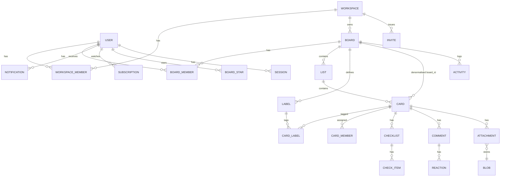

# 05 · Proposed data model

All of this is **INF (Flowdeck design)**. Trello evidence that shaped it is cited inline. Target store: **PostgreSQL 16+**. IDs are UUIDv7 (time-sortable, URL-safe), plus an 8-char `short_id` for board/card URLs (mirrors Trello's short links, OBS O01).

## Entity relationships

## Tables

Common columns on mutable entities: `id uuid pk`, `created_at timestamptz`, `updated_at timestamptz`, `version bigint not null default 1` (optimistic concurrency, see 07). Archive is `archived_at timestamptz null` (soft, reversible, DOC D03). Hard delete removes the row and cascades.

### Identity

| Table | Columns | Rules |
|---|---|---|
| `users` | email (citext unique), username (unique, 3–32, `^[a-z0-9_]+$`, API A01), full_name (1–100, trimmed), initials (1–4), avatar_blob_id?, bio (≤16384), password_hash (argon2id), is_system_admin, disabled_at?, prefs jsonb `{colorBlind, shortcuts, locale, timezone?, emailDigest: never/periodic/instant}` | timezone nullable (OBS O01) |
| `sessions` | user_id, token_hash, user_agent, ip_hash, last_seen_at, expires_at | HttpOnly cookie; rotate on login |
| `totp_factors` (later) | user_id, secret_enc, confirmed_at | |
| `password_resets` | user_id, token_hash, expires_at, used_at | single use, 1 h |

### Workspaces

| Table | Columns | Rules |
|---|---|---|
| `workspaces` | slug (unique, 3–50), name (1–100), description, settings jsonb `{membersCanInvite:false, defaultBoardVisibility:'workspace'}` | |
| `workspace_members` | workspace_id, user_id, role `admin|member`, joined_at | pk (workspace_id,user_id); ≥1 admin |
| `invites` | workspace_id, board_id?, email?, token_hash, role, created_by, expires_at, revoked_at, accepted_by?, kind `email|link` | links reusable until revoked |

### Boards

| Table | Columns | Rules |
|---|---|---|
| `boards` | workspace_id, short_id, name (1–200), description (≤16384), visibility `private|workspace|public`, background jsonb, prefs jsonb `{comments, invitations, selfJoin, cardCovers, cardCounts, voting}`, is_template, closed_at?, source_board_id? | enums from OBS O01; close ≠ delete (D21) |
| `board_members` | board_id, user_id, role `admin|member|observer` | ≥1 admin; guests = user not in workspace_members |
| `board_stars` | user_id, board_id, position | API A01 `boardStars` |
| `lists` | board_id, name (1–200), position (text, fractional key, see 07), archived_at?, version | |
| `labels` | board_id, name (0–100), color (one of 30 Flowdeck palette keys or null), position | per board (D26) |

### Cards

| Table | Columns | Rules |
|---|---|---|
| `cards` | board_id, list_id, short_id, name (1–512), description (Markdown ≤16384), position, start_at?, due_at?, due_reminder_minutes?, due_complete bool, cover jsonb `{color?|attachmentId?, size:'normal'|'full'}`, archived_at?, created_by, version | board_id must equal list.board_id (constraint via trigger) |
| `card_labels` | card_id, label_id | label.board_id = card.board_id |
| `card_members` | card_id, user_id | user ∈ board_members |
| `checklists` | card_id, name (1–200), position | |
| `check_items` | checklist_id, name (1–1000), position, checked_at?, assignee_id?, due_at? | move only within same card (OBS O01) |
| `comments` | card_id, author_id, body (Markdown 1–16384), edited_at?, deleted_at? | delete is hard (D22); keep tombstone in activity only |
| `reactions` (later) | comment_id, user_id, emoji | unique (comment,user,emoji) |
| `attachments` | card_id, uploader_id, kind `file|link`, name (≤256), url?, blob_id?, mime_type, bytes, scan_status `pending|clean|infected|skipped` | A01 name/mime ≤256; OBS `isMalicious` |
| `blobs` | sha256 (unique), bytes, mime_type, storage_key, ref_count, created_at | content-addressed, dedup |
| `custom_fields` (later) | board_id, name, type `checkbox|date|list|number|text`, options jsonb, position | D17; type immutable |
| `custom_field_values` (later) | card_id, field_id, value jsonb | |

### Activity, notifications, subscriptions

| Table | Columns | Rules |
|---|---|---|
| `activity` | board_id, card_id?, list_id?, actor_id, type (specific enum, e.g. `card.moved`, `card.due_changed`, `comment.added`), data jsonb (before/after), created_at, seq bigint | append-only; `seq` per board, monotonically increasing; drives realtime (06) |
| `subscriptions` | user_id, target_type `board|list|card`, target_id | watch (D12) |
| `notifications` | user_id, activity_id, read_at? | fan-out from activity to watchers + mentioned users |
| `audit_log` | actor_id, action, target, ip_hash, created_at | admin/security events only |

Activity types (INF, covers OBS O01 action list): `card.created|renamed|described|moved|copied|archived|restored|deleted|completed|uncompleted|due_changed|start_changed|cover_changed`, `card.member_added|member_removed`, `card.label_added|label_removed`, `checklist.added|removed|renamed`, `check_item.added|checked|unchecked|renamed|moved|deleted`, `comment.added|edited|deleted`, `attachment.added|removed`, `list.created|renamed|moved|archived|restored|deleted`, `board.created|renamed|closed|reopened|visibility_changed|member_added|member_removed|role_changed`.

## Indexes (minimum)

`cards(list_id, position) where archived_at is null` · `cards(board_id) ` · `lists(board_id, position) where archived_at is null` · `activity(board_id, seq)` · `activity(card_id, created_at desc)` · `notifications(user_id, read_at, created_at desc)` · full-text: `cards` generated `tsvector` over name + description, plus `comments.body` (search, 06).

## Operational limits (configurable, defaults mirror DOC D14)

| Object | Default limit |
|---|---|
| Open cards per board | 5000 (warn at 4500) |
| Open lists per board | 475 (warn 450); total lists 2850 |
| Labels per board | 950 |
| Checklists per board | 15200 |
| Checklists per card / items per checklist | 50 / 200 (INF; 3P T04 is dated) |
| Attachments per card | 100 (INF) |
| Upload size | 25 MB default, admin-configurable (INF; Trello free 10 MB / paid 250 MB per 3P T02) |
